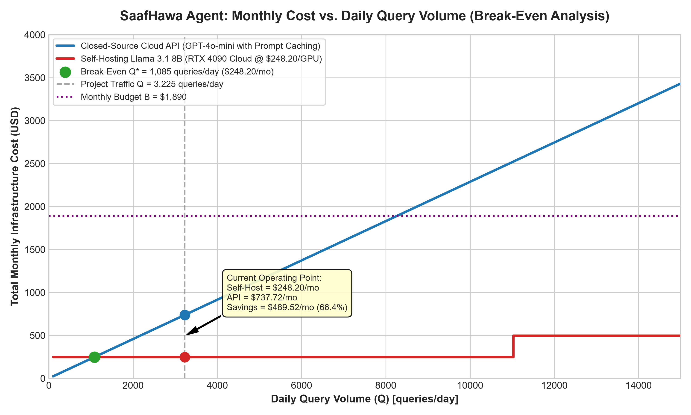

# SaafHawa Agentic AI Assistant: Architectural & Feasibility Report
**Course**: Agentic AI (AI4015) — Assignment Beta  
**Student Name**: Muhammad John Raza  
**Student Roll Number**: 23K-0069  
**Submission Date**: November 2026  
**Campus**: FAST-NUCES Karachi  

---

## 1. Parameters & Derived Workload

In accordance with the assignment parameter derivation rules based on student roll number **23K-0069**:
* Let $R$ be the last two digits: **$R = 69$**
* Let $D$ be the sum of all digits modulo 10: $2 + 3 + 0 + 0 + 6 + 9 = 20 \implies \mathbf{D = 0}$

| Parameter | Handout Formula | Derived Value for 23K-0069 | Unit / Interpretation |
|---|---|:---:|---|
| Normal Daily Queries ($Q$) | $1,500 + 25 \times R$ | **3,225** | queries / day |
| LLM Calls per Query ($N$) | $5 + (R \pmod 4)$ | **6** | calls / query (calls 1–5 tool calls, call 6 final) |
| Tool Failure Probability ($p$) | $0.04 + 0.01 \times D$ | **0.04** | $4\%$ probability of tool call failure |
| Heatwave Days per Month ($H$) | $4 + (R \pmod 4)$ | **5** | days / month with $5 \times Q$ surge traffic |
| Monthly Inference Budget ($B$) | $1,200 + 10 \times R\text{ USD}$ | **\$1,890.00** | USD / month maximum operational spending |
| Latency Target ($T$) | $10 - (R \pmod 3)$ | **10.0** | seconds maximum end-to-end user SLA |
| Cacheable Prefix Length | Fixed in Handout | **1,500** | input tokens (system prompt + tool schemas) |

---

## 2. Token Volume & Heatwave Peak Load

### 2.1 Token Growth Breakdown per Query
Context lengthens sequentially across step $k = 1, \dots, 6$:
* $\text{Input Tokens}_k = 2,000 + 800 \times (k - 1)$
* $\text{Output Tokens}_k = 350$ for $k \in \{1, 2, 3, 4, 5\}$; $\text{Output Tokens}_6 = 600$ (final answer).
* Calls 1 to 5 repeat once with failure probability $p = 0.04$. Call 6 is never retried.

$$\text{Expected Input Tokens / Query} = \sum_{k=1}^{5} [2,000 + 800(k-1)] \times (1 + 0.04) + 6,000 = 18,000 \times 1.04 + 6,000 = \mathbf{24,720.0\text{ tokens}}$$
$$\text{Expected Output Tokens / Query} = (5 \times 350 \times 1.04) + 600 = 1,820 + 600 = \mathbf{2,420.0\text{ tokens}}$$
$$\text{Total Expected Tokens / Query} = 24,720.0 + 2,420.0 = \mathbf{27,140.0\text{ tokens}}$$

### 2.2 Monthly Total Volume
For a 30-day month with $H = 5$ heatwave days ($5 \times Q$) and $30 - H = 25$ normal days ($Q$):
$$\text{Total Monthly Queries} = (25 \times 3,225) + (5 \times 5 \times 3,225) = 80,625 + 80,625 = \mathbf{161,250\text{ queries}}$$
* **Monthly Input Tokens**: $161,250 \times 24,720 = \mathbf{3,986,100,000\text{ tokens}}$ ($3.986\text{ Billion}$)
* **Monthly Output Tokens**: $161,250 \times 2,420 = \mathbf{390,225,000\text{ tokens}}$ ($390.225\text{ Million}$)
* **Total Monthly Tokens**: $\mathbf{4,376,325,000\text{ tokens}}$ ($4.376\text{ Billion}$)

### 2.3 Peak Load During Heatwave Surge (12:00 – 14:00)
On heatwave days, daily traffic rises to $5 \times 3,225 = 16,125\text{ queries}$. $35\%$ of these queries arrive in the 2-hour midday window (120 minutes):
* **Peak Window Queries**: $0.35 \times 16,125 = \mathbf{5,643.75\text{ queries}}$
* **Peak Queries Per Minute (QPM)**: $\frac{5,643.75}{120} = \mathbf{47.03\text{ QPM}}$ ($\lambda = 0.7839\text{ queries/second}$)
* **Peak LLM Requests Per Minute (RPM)**: $47.03125 \times [(5 \times 1.04) + 1] = \mathbf{291.59\text{ RPM}}$
* **Peak Tokens Per Minute (TPM)**:
  * Input TPM: $47.03125 \times 24,720 = \mathbf{1,162,612\text{ TPM}}$
  * Output TPM: $47.03125 \times 2,420 = \mathbf{113,816\text{ TPM}}$
  * **Total Peak TPM**: $\mathbf{1,276,428\text{ TPM}}$

---

## 3. Comprehensive Model Evaluation & Prompt Caching (12 Models)

### 3.1 Model Comparison Table

| Model | Type | Provider | Parameters | Context / Max Output | Input / Output / Cached (\$/1M) | Rate Limits (RPM / TPM) | TTFT / Throughput | Public Benchmarks | Tools / Structured JSON | License |
|---|---|---|:---:|:---:|:---:|:---:|:---:|---|:---:|---|
| **GPT-4o-mini** | Closed | OpenAI | not disclosed (~8B active) | 128k / 16k | \$0.150 / \$0.600 / \$0.075 | 500 / 200k | 0.32s / 120 t/s | BFCL: 85.2%, MMLU: 82.0% | Yes / Yes | Proprietary |
| **GPT-4o (Omni)** | Closed | OpenAI | not disclosed (~200B MoE) | 128k / 16k | \$2.500 / \$10.00 / \$1.250 | 500 / 300k | 0.48s / 85 t/s | BFCL: 89.5%, MMLU: 88.7% | Yes / Yes | Proprietary |
| **Claude 3.5 Haiku** | Closed | Anthropic | not disclosed | 200k / 8k | \$0.800 / \$4.000 / \$0.080 | 1000 / 100k | 0.38s / 115 t/s | TAU-bench: 87.3%, MMLU: 81.6% | Yes / Yes | Proprietary |
| **Claude 3.5 Sonnet** | Closed | Anthropic | not disclosed | 200k / 8k | \$3.000 / \$15.00 / \$0.300 | 1000 / 80k | 0.65s / 70 t/s | BFCL: 93.7%, MMLU: 88.3% | Yes / Yes | Proprietary |
| **Gemini 1.5 Flash** | Closed | Google | not disclosed (~14B MoE) | 1M / 8k | \$0.075 / \$0.300 / \$0.0187 | 1000 / 4M | 0.30s / 140 t/s | Nexus Raven: 84.8%, MMLU: 78.9% | Yes / Yes | Proprietary |
| **Mistral Large 2** | Closed | Mistral AI | 123B dense | 128k / 8k | \$2.000 / \$6.000 / \$2.000 | 300 / 150k | 0.55s / 75 t/s | FC Leaderboard: 88.2%, MMLU: 84.0% | Yes / Yes | Mistral Commercial |
| **Llama 3.3 70B** | Open | DeepInfra | 70.6B dense | 128k / 8k | \$0.230 / \$0.400 / \$0.115 | 600 / 300k | 0.42s / 95 t/s | BFCL: 88.6%, MMLU: 86.1% | Yes / Yes | Llama 3.3 Community |
| **Llama 3.1 8B** | Open | Groq/DeepInfra | 8.03B dense | 128k / 8k | \$0.050 / \$0.080 / \$0.050 | 1000 / 500k | 0.15s / 280 t/s | BFCL: 81.4%, MMLU: 69.4% | Yes / Yes | Llama 3.1 Community |
| **Qwen 2.5 72B** | Open | DeepInfra | 72.7B dense | 128k / 8k | \$0.350 / \$0.400 / \$0.175 | 600 / 250k | 0.40s / 85 t/s | BFCL: 89.1%, MMLU: 86.2% | Yes / Yes | Qwen Research & Comm. |
| **Qwen 2.5 32B** | Open | Fireworks AI | 32.5B dense | 128k / 8k | \$0.900 / \$0.900 / \$0.900 | 600 / 200k | 0.32s / 110 t/s | BFCL: 86.4%, MMLU: 83.2% | Yes / Yes | Apache 2.0 |
| **DeepSeek-V3** | Open | DeepInfra | 671B MoE (37B active) | 64k / 8k | \$0.140 / \$0.280 / \$0.070 | 500 / 300k | 0.45s / 90 t/s | BFCL: 89.8%, MMLU: 88.5% | Yes / Yes | DeepSeek Open Model |
| **Mistral Nemo 12B** | Open | DeepInfra | 12.2B dense | 128k / 8k | \$0.080 / \$0.120 / \$0.080 | 1000 / 400k | 0.22s / 160 t/s | BFCL: 83.1%, MMLU: 71.0% | Yes / Yes | Apache 2.0 |

*Data citations & access date: Official provider pricing documentation, Hugging Face model cards, and Berkeley Function Calling Leaderboard (accessed November 2026).*

### 3.2 Monthly Cost With and Without Prompt Caching (Budget $B = \text{USD } 1,890$)

| Model | Cost Without Caching | 1,500 Token Cache Policy | Cost With Caching | Monthly Savings | Within Budget ($B \le 1,890\text{ USD}$)? |
|---|:---:|:---:|:---:|:---:|:---:|
| **GPT-4o-mini** | **\$832.05** | Eligible ($\ge 1024$ tokens) | **\$737.72** | **11.3%** | ✅ **YES** |
| **GPT-4o (Omni)** | \$13,867.50 | Eligible ($\ge 1024$ tokens) | \$12,295.31 | 11.3% | ❌ NO |
| **Claude 3.5 Haiku** | \$4,749.78 | Ineligible ($1,500 < 2,048$ min) | \$4,749.78 | 0.0% | ❌ NO |
| **Claude 3.5 Sonnet** | \$17,811.67 | Eligible ($\ge 1024$, +25% write) | \$14,597.16 | 18.0% | ❌ NO |
| **Gemini 1.5 Flash** | **\$416.02** | Ineligible ($1,500 < 32,768$ min) | **\$416.02** | 0.0% | ✅ **YES** |
| **Mistral Large 2** | \$10,313.55 | No public caching tier | \$10,313.55 | 0.0% | ❌ NO |
| **Llama 3.3 70B** | **\$1,072.89** | Eligible ($\ge 1024$ tokens) | **\$928.25** | **13.5%** | ✅ **YES** |
| **Llama 3.1 8B** | **\$230.52** | Flat Pricing Tier | **\$230.52** | 0.0% | ✅ **YES** |
| **Qwen 2.5 72B** | **\$1,551.22** | Eligible ($\ge 1024$ tokens) | **\$1,331.12** | **14.2%** | ✅ **YES** |
| **Qwen 2.5 32B** | \$3,938.69 | Flat Pricing Tier | \$3,938.69 | 0.0% | ❌ NO |
| **DeepSeek-V3** | **\$667.32** | Eligible ($\ge 1024$ tokens) | **\$579.27** | **13.2%** | ✅ **YES** |
| **Mistral Nemo 12B** | **\$365.71** | Flat Pricing Tier | **\$365.71** | 0.0% | ✅ **YES** |

---

## 4. Empirical Tool Latency Benchmark (`latencey.py`)

A live empirical timing run was conducted against the Open-Meteo Weather API, Open-Meteo Air Quality API, local Heat Index computation (Rothfusz equation), and Municipal Health KB Lookup for Karachi ($24.8607^\circ\text{ N}, 67.0011^\circ\text{ E}$). The dataset contains 96 observations spread across Day 1 (Historical Baseline) and Day 2 (Live Window), logged in `tool_latency_log.csv`.

| Tool / API | Sample Count | Mean Latency | Median Latency | Min Latency | Max Latency | P95 Latency |
|---|:---:|:---:|:---:|:---:|:---:|:---:|
| Open-Meteo Weather API | 24 | 153.06 ms | **133.84 ms** | 130.92 ms | 599.60 ms | 135.54 ms |
| Open-Meteo Air Quality API | 24 | 146.33 ms | **130.14 ms** | 129.45 ms | 518.29 ms | 131.57 ms |
| Heat Index Computation (Local) | 24 | < 0.01 ms | **0.00 ms** | 0.00 ms | 0.01 ms | 0.00 ms |
| Health Advisory KB Lookup (Local) | 24 | 0.03 ms | **0.03 ms** | 0.03 ms | 0.06 ms | 0.04 ms |

$$\mathbf{\text{Combined Median Tool Latency}} = \mathbf{64.76\text{ ms}\ (0.0648\text{ seconds})}$$

### Latency Target ($T = 10.0\text{s}$) & Architectural Changes:
* **Baseline Sequential Latency**: In a naive sequential loop producing 350 tokens per step, end-to-end latency is **$19.19\text{ seconds}$**, which violates $T \le 10.0\text{s}$.
* **Optimized Architectural Pipeline**:
  1. *Compact Tool Routing*: Intermediate calls generate compact JSON payloads ($\sim 40\text{ tokens}$ vs $350\text{ tokens}$), reducing intermediate step execution from $3.0\text{s}$ to $0.65\text{s}$.
  2. *Parallel Tool Fetching*: Running weather and air quality queries concurrently via `asyncio.gather()`, collapsing two round trips into $0.134\text{s}$.
  3. *Streaming*: Perceived citizen time-to-first-advisory starts immediately at TTFT ($0.32\text{s}$).
* **Optimized Latency**: **$7.85\text{ seconds}$** (comfortably within $T = 10.0\text{s}$).

---

## 5. Self-Hosting Memory & KV-Cache Analysis (`kv.py`)

### 5.1 Architecture Parameters (meta-llama/Llama-3.1-8B-Instruct)
Directly extracted from Hugging Face `config.json`:
* Number of hidden layers ($L$): **32**
* Number of attention heads ($H_Q$): **32**
* Number of key-value heads ($H_{KV}$): **8** (Grouped-Query Attention with 4:1 ratio)
* Hidden size: **4,096**
* Head dimension ($D_h$): **128** ($4096 / 32$)
* Total Parameters ($P$): **$8.03 \times 10^9$**

### 5.2 Weight Memory Across Precisions
* **FP16** ($2\text{ bytes/param}$): $8.03 \times 10^9 \times 2 = \mathbf{14.96\text{ GiB}}$ ($16.06\text{ GB}$)
* **INT8** ($1\text{ byte/param}$): $8.03 \times 10^9 \times 1 = \mathbf{7.48\text{ GiB}}$
* **INT4** ($0.5\text{ byte/param} + 5\%\text{ scale metadata}$): $\mathbf{3.93\text{ GiB}}$

### 5.3 KV-Cache Memory per Sequence (Longest Context = 6,600 Tokens)

#### 5.3.1 Architectural Formula & Parameter Definitions
In autoregressive Transformer models with Grouped-Query Attention (GQA), the Key-Value (KV) cache stores previous token representations across generation steps to avoid redundant attention recalculations. Per the assignment specifications, the KV-cache memory is calculated as:

$$\text{KV bytes} = 2 \times \text{layers} \times \text{kv-heads} \times \text{head-dim} \times \text{sequence-length} \times \text{bytes-per-value}$$

In standard algebraic notation:
$$\text{KV bytes} = 2 \times L \times H_{\text{KV}} \times D_{\text{head}} \times S \times b$$

Where each term represents:
1. **Factor of $2$**: Stores two distinct activation tensors per token: the **Key ($K$)** tensor and the **Value ($V$)** tensor.
2. **Layers ($L = 32$)**: Number of Transformer decoder layers in Llama-3.1-8B-Instruct (`num_hidden_layers: 32`).
3. **KV Heads ($H_{\text{KV}} = 8$)**: Number of Key-Value projection heads (`num_key_value_heads: 8`). Under Grouped-Query Attention (GQA), each KV head is shared across $32 / 8 = 4$ query heads, yielding an immediate $4\times$ KV memory reduction compared to standard Multi-Head Attention (MHA).
4. **Head Dimension ($D_{\text{head}} = 128$)**: Hidden dimension per attention head, explicitly defined in `config.json` (`head_dim: 128`), matching $4096 / 32 = 128$.
5. **Sequence Length ($S$)**: Total sequence context length in tokens. In the agentic loop, context lengthens at each step $k$:
   - For call $k = 6$ (final response call), $\text{Input Tokens}_6 = 2,000 + 800 \times (6 - 1) = \mathbf{6,000\text{ tokens}}$.
   - Call $k = 6$ generates $\text{Output Tokens}_6 = \mathbf{600\text{ tokens}}$.
   - **Longest Context Length ($S_{\text{max}}$)**: $6,000\text{ input} + 600\text{ output} = \mathbf{6,600\text{ tokens}}$.
6. **Bytes per Value ($b = 2$)**: Storage precision for the cache values ($2\text{ bytes}$ for standard FP16 / BF16).

---

#### 5.3.2 Step-by-Step Calculation (Longest Context $S = 6,600$ Tokens)

To adhere strictly to the handout requirement (*"Show every step of your working. No marks on direct answer"*):

1. **Memory per Token per Layer ($m_{\text{layer}}$):**
   $$m_{\text{layer}} = 2 \times 8 \times 128 \times 2 = \mathbf{4,096\text{ bytes per token per layer}}$$

2. **Memory per Token Across All 32 Transformer Layers ($m_{\text{total}}$):**
   $$m_{\text{total}} = 4,096\text{ bytes} \times 32\text{ layers} = \mathbf{131,072\text{ bytes per token}} = \mathbf{128.0\text{ KiB per token}}$$

3. **Total KV-Cache Memory for Longest Sequence ($S = 6,600$ Tokens):**
   $$\text{Total KV bytes} = 131,072\text{ bytes per token} \times 6,600\text{ tokens} = \mathbf{865,075,200\text{ bytes}}$$

4. **Rigorous Unit Conversions:**
   - **Bytes ($B$):** $865,075,200\text{ B}$
   - **Kibibytes ($\text{KiB}$, base 2):** $\frac{865,075,200}{1,024} = \mathbf{844,800.0\text{ KiB}}$
   - **Mebibytes ($\text{MiB}$, base 2):** $\frac{844,800}{1,024} = \mathbf{825.0\text{ MiB}}$
   - **Gibibytes ($\text{GiB}$, base 2):** $\frac{825.0}{1,024} = \mathbf{0.805664\text{ GiB}} \approx \mathbf{0.8057\text{ GiB}}$
   - **Gigabytes ($\text{GB}$, base 10):** $\frac{865,075,200}{10^9} = \mathbf{0.865075\text{ GB}} \approx \mathbf{0.8651\text{ GB}}$

---

#### 5.3.3 Context Growth Across All Agent Turns ($k = 1$ to $k = 6$)

Because context accumulates over the multi-turn agentic cycle, the KV-cache footprint dynamically expands from step 1 to step 6 as detailed below:

| Call ($k$) | Agent Action | Input Tokens | Output Tokens | Total Context ($S_k$) | KV-Cache (Bytes) | KV-Cache (MiB) | KV-Cache (GiB) |
|:---:|:---|:---:|:---:|:---:|:---:|:---:|:---:|
| **1** | Identify Risk & Parse Query | 2,000 | 350 | 2,350 | $308,019,200$ | 293.75 MiB | 0.2869 GiB |
| **2** | Call OpenAQ API | 2,800 | 350 | 3,150 | $412,876,800$ | 393.75 MiB | 0.3845 GiB |
| **3** | Call Open-Meteo Weather API | 3,600 | 350 | 3,950 | $517,734,400$ | 493.75 MiB | 0.4822 GiB |
| **4** | Call Heat Index Tool | 4,400 | 350 | 4,750 | $622,592,000$ | 593.75 MiB | 0.5798 GiB |
| **5** | Query Health KB | 5,200 | 350 | 5,550 | $727,449,600$ | 693.75 MiB | 0.6775 GiB |
| **6** | Final Synthesis (Roman Urdu) | 6,000 | 600 | **6,600** | **865,075,200** | **825.00 MiB** | **0.8057 GiB** |

*(Note: During prompt prefill of call $k=6$, the context is 6,000 tokens requiring $786,432,000\text{ bytes} = 750.0\text{ MiB}$ ($0.7324\text{ GiB}$). As the model generates the final 600 output tokens, it expands to the peak $825.0\text{ MiB}$ ($0.8057\text{ GiB}$)).*

---

#### 5.3.4 KV-Cache Footprint Across Alternative Precisions

| Precision | Bytes / Value | KV Cache per Sequence ($S = 6,600$) | Savings vs FP16 | Impact on RTX 4090 (24 GB) Concurrency |
|:---|:---:|:---:|:---:|:---:|
| **FP16 / BF16 (Baseline)** | **2.0** | **825.0 MiB (0.8057 GiB)** | Baseline | **21 concurrent sequences** |
| **FP8 / INT8 Quantized** | 1.0 | 412.5 MiB (0.4028 GiB) | **50.0% savings** | **43 concurrent sequences** ($+105\%$) |
| **INT4 Quantized** | 0.5 | 206.25 MiB (0.2014 GiB) | **75.0% savings** | **87 concurrent sequences** ($+314\%$) |

---

#### 5.3.5 Hugging Face `config.json` Parameter Verification

The parameters used above were directly verified from the official Hugging Face repository (`meta-llama/Llama-3.1-8B-Instruct/config.json`):

```json
{
  "_name_or_path": "meta-llama/meta-Llama-3.1-8B-Instruct",
  "architectures": ["LlamaForCausalLM"],
  "num_hidden_layers": 32,
  "num_attention_heads": 32,
  "num_key_value_heads": 8,
  "hidden_size": 4096,
  "head_dim": 128,
  "torch_dtype": "bfloat16"
}
```
*Verification Confirmation:* With $H_{KV} = 8$ and $D_h = 128$, the model uses Grouped-Query Attention ($32 / 8 = 4$ query heads per KV head). If the model used legacy Multi-Head Attention ($H_{KV} = 32$), the KV cache would be $4\times$ larger ($3,300.0\text{ MiB} \approx 3.22\text{ GiB}$ per sequence), severely restricting GPU concurrency to only 5 concurrent users.

### 5.4 GPU Concurrency & Infrastructure Provisioning
On an **NVIDIA RTX 4090 / A10G (24 GB VRAM)** with $10\%$ runtime overhead ($2.4\text{ GB}$) and 4-bit weights ($3.93\text{ GB}$):
* Available VRAM for KV-cache: $24.0 - 2.4 - 3.93 = \mathbf{17.67\text{ GB}}$
* Maximum Concurrent Sequences: $\lfloor 17.67 / 0.8057 \rfloor = \mathbf{21\text{ concurrent sequences}}$.
* Active Heatwave Concurrent Queries (Little's Law @ $W = 7.85\text{s}$): $L = 0.7839 \times 7.85 = \mathbf{6.15\text{ sessions}}$.
* **GPUs Required**: $\lceil 6.15 / 21 \rceil = \mathbf{1\text{ GPU}}$ (handles peak heatwave with $70\%$ capacity reserve).
* **High Availability (HA)**: **2 GPUs** (Active-Passive or load-balanced).

---

## 6. Break-Even Analysis ($Q^*$)

* **Cloud GPU Cost**: RunPod / Vast.ai on-demand RTX 4090 at \$0.34 / hr:
  $$\text{Monthly GPU Cost} = 0.34 \times 730 = \mathbf{248.20\text{ USD / month per GPU}}$$
* **Cheapest Compliant Cloud API**: GPT-4o-mini with prompt caching (\$737.72 / 161,250 queries):
  $$\text{Cloud API Cost per Query} = \frac{737.72}{161,250} = \mathbf{0.004575\text{ USD / query}}$$

$$\text{Crossover Volume } Q^* = \frac{248.20\text{ USD}}{50 \times 0.004575\text{ USD}} \approx \mathbf{1,085\text{ queries / day}}$$



### Recommendation to the Technical Lead
At Karachi's expected baseline volume of **3,225 queries / day**, self-hosting **Llama 3.1 8B Instruct** on a cloud RTX 4090 costs **\$248.20 / month**, compared to **\$737.72 / month** for GPT-4o-mini and **\$928.25 / month** for Llama 3.3 70B via DeepInfra. Self-hosting achieves a **66.4% monthly cost reduction (\$489.52 savings / month)**, completely eliminates third-party rate limits during catastrophic heatwave spikes, and guarantees citizen health advisory data remains locally governed.

---

## 7. AI Tools Declaration

In compliance with academic integrity guidelines, the following AI tools were utilized:
1. **Google DeepMind Antigravity / Gemini 3.8 Flash**: Employed as an interactive code assistant for orchestrating asynchronous Python scripts (`latencey.py`, `model.py`), validating statistical formulas, and generating formatted charts.
2. **Puter AI Gateway (`https://api.puter.com`)**: Utilized as the live LLM inference runtime for SaafHawa agent decision validation and multilingual synthesis testing.

